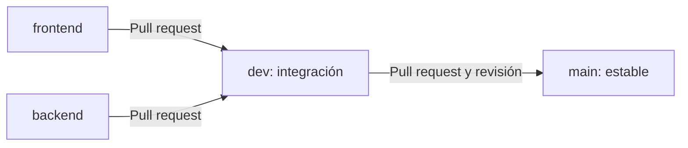

# Dumbo Supermercados

Proyecto del equipo: **Angular 20 + .NET 10 + PostgreSQL**. Esta es la base de desarrollo; las funcionalidades del supermercado se incorporarán por tareas.

## Probar todo desde una terminal

Necesitas **Git y Docker Desktop abierto**. Para esta opción, Node y .NET se ejecutan dentro de Docker.

La primera vez:

```powershell
git clone https://github.com/pvblo47/dumbo-supermercado.git
cd dumbo-supermercado
Copy-Item .env.example .env
```

En Linux/macOS, usar `cp .env.example .env`. Abrir `.env` y cambiar `POSTGRES_PASSWORD` por una clave local de desarrollo. Este archivo no se sube a Git.

Desde esa misma terminal:

```sh
docker compose up --build -d
```

**Abrir la aplicación: http://localhost:8080**

Este comando levanta frontend, API y base de datos en segundo plano. Puedes seguir usando la misma terminal o cerrarla; los servicios continúan funcionando mientras Docker esté abierto. La primera construcción puede tardar varios minutos.

Para detenerlos y conservar los datos:

```sh
docker compose down
```

Si cambiaste código, repetir `docker compose up --build -d` para reconstruir lo modificado. Para trabajar con el servidor de desarrollo de cada parte, usar la opción correspondiente de abajo.

## Trabajar en tu parte

Los comandos siguientes parten de la raíz del repositorio. Cada integrante puede iniciar solo la parte que está desarrollando.

### Frontend

Necesitas **Node.js 24 y npm 11**.

```sh
git switch frontend
cd frontend
npm ci
npm start
```

Abrir http://localhost:4200. `npm ci` instala las dependencias; repetirlo al cambiar el archivo de dependencias. Angular muestra el estado de la API: para probar el flujo integrado, la API debe estar ejecutándose también.

### Backend

Necesitas el **SDK .NET 10**.

```sh
git switch backend
dotnet run --project backend/src/Dumbo.Api --launch-profile http
```

Comprobar la API en http://localhost:5080/api/health. Para conectarla a PostgreSQL local, seguir la [configuración de la base de datos](docs/GUIA_TECNICA.md#desarrollar-angular-y-net-por-separado).

El arranque local de Angular y .NET usa una terminal por proceso cuando quieres desarrollar ambos a la vez. Para probar todo junto desde una terminal, usa Docker como se indica arriba. Detén los servicios Docker antes de cambiar al arranque local para evitar ocupar el mismo puerto de la API.

## Cómo subimos los cambios



1. **Trabaja en `frontend` o `backend`**. Antes de comenzar, actualiza tu rama con `git pull --ff-only`.
2. Guarda y sube los archivos de tu tarea. Ejemplo para frontend, desde la raíz:

   ```sh
   git add frontend/
   git commit -m "feat: describir la tarea"
   git push origin frontend
   ```

3. En GitHub, abre un **pull request hacia `dev`**. Otro integrante revisa los cambios y se comprueba CI.
4. Cuando lo integrado esté listo, abre un **pull request de `dev` hacia `main`**.

Usar **Create a merge commit** y conservar las cuatro ramas. El botón de GitHub puede proponer `main` como destino: cambiarlo a `dev` cuando se integra frontend o backend.

Las protecciones se activan en la configuración de GitHub; guardar su archivo en el repositorio no las activa. El detalle de las reglas y cómo sincronizar ramas está en la [guía técnica](docs/GUIA_TECNICA.md#trabajo-en-equipo).

## Más información

- [Guía técnica](docs/GUIA_TECNICA.md): base de datos, migraciones, pruebas, ramas y configuración.
- [Arquitectura en capas](docs/ARQUITECTURA.md).
- [Contratos de la API](docs/CONTRATOS_API.md).
- [Primeras tareas del equipo](docs/ARRANQUE_EQUIPO.md).

CI ya compila, prueba y construye las imágenes. La publicación de imágenes y el despliegue automático en la VM todavía deben configurarse.
