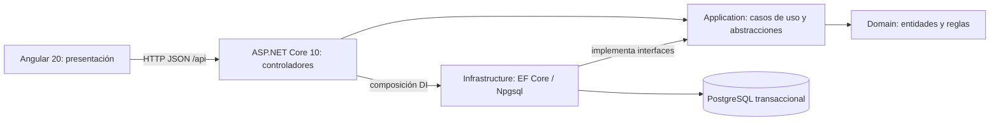

# Arquitectura de la base

Angular es la presentación. Los controladores HTTP de la API invocan casos de uso de Application. Domain conserva entidades/reglas. Infrastructure implementa persistencia e integraciones y se registra desde la composición de la API.

Las flechas entre proyectos representan dependencias, no contenedores C4 o Docker. Esta solución aplica MVC en capas con Angular separado: vista en frontend, controladores en API y modelo/reglas/persistencia distribuidos entre las capas del backend.

No poner SQL en controladores ni reglas de negocio en componentes Angular. No exponer entidades EF directamente como respuesta de la API. Autorizar y revalidar entradas en el backend cuando se incorporen los casos de uso.

El único caso técnico inicial es disponibilidad: el controlador de readiness consulta una abstracción de Application, implementada en Infrastructure mediante EF. Domain está preparado para recibir el modelo acordado; no contiene entidades ficticias para dar por terminado un RF.

## Decisiones que faltan antes de modelar cuentas y compras

- Confirmar ASP.NET Core Identity y el mecanismo de sesión. La propuesta previa era cookie HttpOnly/Secure con antifalsificación para la aplicación bajo un mismo origen; aún no se implementa autenticación.
- Definir el carrito y sus restricciones, sin RUT ni precios aceptados desde el navegador.
- Validar transiciones de cuenta, reserva/pago e idempotencia con el ERS actualizado. D07 debe revisarse como propuesta, no como aprobación del profesor.
- Preparar notificaciones/reintentos, conciliación Webpay y consolidación de RF-008 en su etapa correspondiente.

La base operacional de este Compose no sustituye al diseño objetivo del worker y la base de reportes. Tampoco decide el reparto de los servicios entre las VM de clase.
