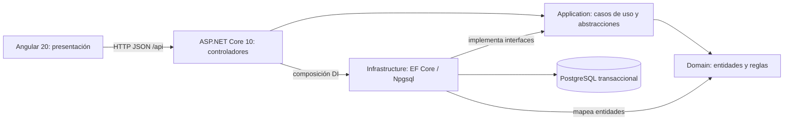

# Arquitectura de la base

Angular es la presentación. Los controladores HTTP de la API invocan casos de uso de Application. Domain conserva entidades/reglas. Infrastructure implementa persistencia e integraciones y se registra desde la composición de la API.

Las flechas entre proyectos representan dependencias, no contenedores C4 o Docker. Esta solución aplica MVC en capas con Angular separado: vista en frontend, controladores en API y modelo/reglas/persistencia distribuidos entre las capas del backend.

| Parte | Responsabilidad | Puede depender de |
| --- | --- | --- |
| Angular | Vistas, interacción y cliente HTTP. | Contrato HTTP de la API, nunca PostgreSQL directamente. |
| Api | Controladores, respuestas HTTP y composición de servicios. | Application e Infrastructure para registrar dependencias. |
| Application | Casos de uso, DTO y abstracciones. | Domain. |
| Domain | Entidades y reglas del negocio. | Ningún otro proyecto de la solución ni EF/ASP.NET. |
| Infrastructure | EF Core/Npgsql, archivos y proveedores externos cuando se implementen. | Application y Domain. |

Un controlador invoca una interfaz de Application; DI conecta esa interfaz con Infrastructure. La referencia de Api a Infrastructure permite esa composición: no autoriza a introducir consultas EF o SQL en los controladores de negocio. El caso de disponibilidad ya sigue este recorrido.

En MVC, Angular es la vista; Api contiene los controladores; Application/Domain representan el modelo y sus casos de uso; Infrastructure materializa la persistencia. El modelo no se limita al DbContext. Las respuestas de la API usan DTO, sin exponer directamente entidades EF.

El único caso técnico inicial es disponibilidad. Domain está preparado para recibir las entidades acordadas, pero todavía está vacío. La autorización y las validaciones de negocio se implementarán en backend; las de Angular no las sustituyen.

## Decisiones que faltan antes de modelar cuentas y compras

- Confirmar ASP.NET Core Identity y el mecanismo de sesión. La propuesta previa era cookie HttpOnly/Secure con antifalsificación para la aplicación bajo un mismo origen; aún no se implementa autenticación.
- Definir el carrito y sus restricciones, sin RUT ni precios aceptados desde el navegador.
- Validar transiciones de cuenta, reserva/pago e idempotencia con el ERS actualizado. D07 debe revisarse como propuesta, no como aprobación del profesor.
- Preparar notificaciones/reintentos, conciliación Webpay y consolidación de RF-008 en su etapa correspondiente.

El despliegue de entrega usa **tres VM distintas**: frontend, backend y PostgreSQL. Las cuatro capas .NET permanecen juntas en la VM backend. La VM frontend sirve los archivos Angular mediante Nginx; Angular se ejecuta en el navegador. El detalle está en [Despliegue en tres VM](DESPLIEGUE_VM.md).

El Compose raíz reúne los servicios solo para trabajo local. No sustituye el despliegue distribuido ni implementa el worker y la base de reportes del diseño objetivo.

## Estado frente al ERS

La revisión de requisitos y sus límites están en [VALIDACION_ERS.md](VALIDACION_ERS.md). La base respeta la dirección de dependencias y prepara la separación por VM. Las plantillas DEV/PROD locales y las configuraciones por VM todavía no acreditan un despliegue real.

Los siguientes elementos pertenecen a la arquitectura objetivo y siguen sin implementarse: autenticación y autorización por rol, modelo/migraciones del supermercado, archivos de imágenes persistentes, Webpay, Resend y consolidación de reportes mediante un worker y una base analítica. El worker de reportes no debe modificar cuentas, ventas o stock del origen ni asumir los reintentos de correo de D06.
