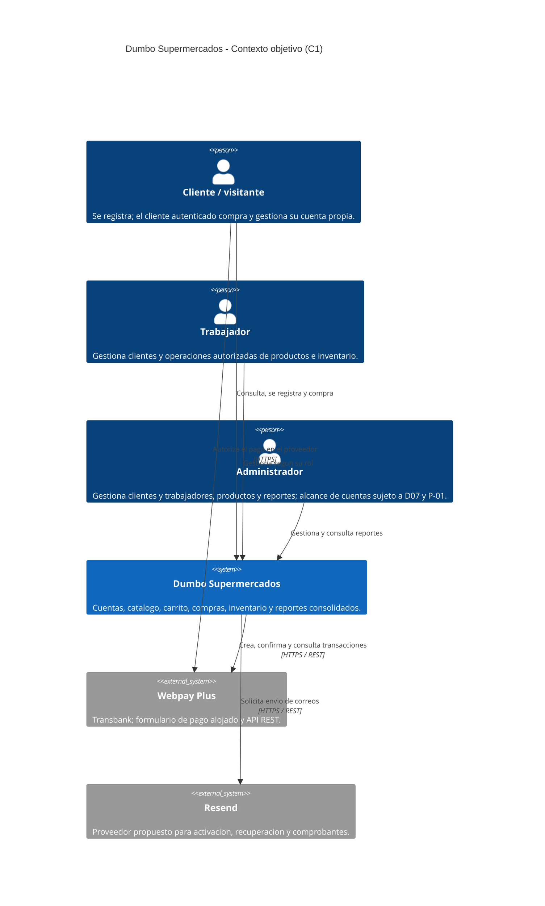
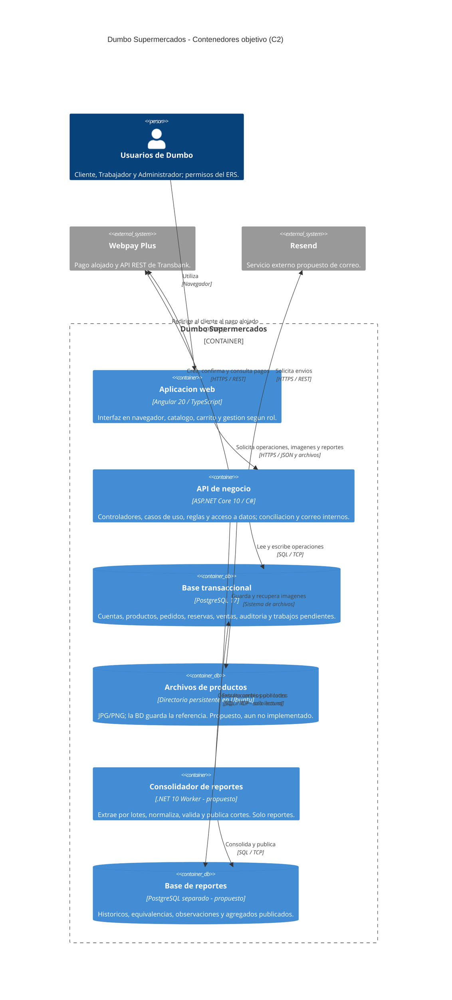
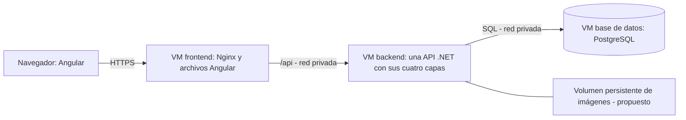

# Arquitectura C4 de Dumbo Supermercados

Actualización: 11 de noviembre de 2026, contra [ERS (5)](ERS.md) y despliegue confirmado en tres VM. **C1 y C2 representan el diseño objetivo**; no afirman que todos los contenedores estén implementados. El [draw.io editable](diagramas/Arquitectura_Dumbo_C4.drawio) contiene las mismas dos vistas. Los originales del Hito 1 se conservan localmente sin sobrescribir.

## C1 — Contexto

Los actores son los roles de negocio, no nombres del equipo. El usuario utiliza el formulario alojado de Webpay; Dumbo no recibe datos de tarjeta. El backend confirma el resultado con el proveedor antes de acreditar una venta. Resend entrega los mensajes; Dumbo conserva reglas de activación, caducidad, pedidos y reintentos.

## C2 — Contenedores

Las respuestas están implícitas. Angular no se conecta a PostgreSQL, no recibe claves de proveedores y no decide permisos, precios finales ni pagos aprobados. Nginx sirve sus archivos y reenvía `/api`; es un detalle de despliegue y no otra capa del negocio.

| Contenedor lógico | Responsabilidad y tecnología | Estado en el repositorio |
| --- | --- | --- |
| Aplicación web | Angular 20 / TypeScript: presentación y cliente HTTP | Base técnica con estado de conectividad. Flujos comerciales pendientes. |
| API de negocio | ASP.NET Core 10: HTTP, autenticación, autorización, negocio e integraciones | Una API por capas; únicamente disponibilidad y conexión a BD implementadas. |
| Base transaccional | PostgreSQL 17, acceso por EF Core/Npgsql | Contenedor/configuración preparados; modelo de negocio y migraciones pendientes. |
| Archivos | Volumen persistente montado en API, VM backend | Propuesto. No confundir guardar en el volumen con guardar dentro de la imagen Docker. |
| Worker | Proceso .NET dedicado a RF-008 | Propuesto; no creado. No envía correo ni escribe ventas, cuentas o stock del origen. |
| Base de reportes | PostgreSQL separado para resultados consolidados | Propuesta; no creada. API de reportes con lectura; worker con escritura. |

**C4 no es Docker:** un contenedor C4 es una aplicación o almacenamiento con una responsabilidad. Las cuatro capas internas de la API no son cuatro contenedores C4. El directorio persistente se representa como almacenamiento C4, pero no requiere un proceso/servicio Docker propio. Las VM son nodos de despliegue.

## MVC en capas

La vista es Angular. Los controladores HTTP están en `Dumbo.Api`. `Application` coordina los casos de uso y sus contratos; `Domain` representa entidades y reglas. `Infrastructure` implementa persistencia, archivos y adaptadores de Webpay/Resend. El modelo no es solo el DbContext.

Dependencias de código: Application → Domain; Infrastructure → Application y Domain; Api → Application e Infrastructure para composición de DI. Domain no depende de EF, HTTP o infraestructura. Un controlador llama a casos de uso; la referencia de composición no permite concentrar SQL en él. Todas las capas ejecutan una API en la VM backend. Detalle y ejemplo verificable en [ARQUITECTURA.md](ARQUITECTURA.md).

## Flujos que justifican las decisiones

### Cuentas y correo — RF-001/002/003/007, NF02

ID interno estable y correo normalizado único, sin RUT. Autorregistro con contraseña propia; alta manual con enlace de activación, no contraseña predecible. API comprueba rol, propietario y estado vigente. P-01 registra la contradicción de eliminación; D07 propone baja lógica, revocación, bloqueo por pagos y conservación de pedidos. No se implementa por quitar un botón de Angular.

La API persiste notificaciones pendientes y las procesa fuera de la transacción de compra, con trabajo interno reanudable. D06 propone máximo cuatro intentos automáticos. No se delega este acceso al worker analítico de solo lectura. Resend, remitente y credenciales aún deben configurarse.

### Compra — RF-005/006, D05

Angular solicita compra; backend revalida cantidades enteras, precio y disponibilidad y crea pedido/reserva en una transacción corta. La llamada a Webpay ocurre fuera de esa transacción. Tras confirmar con Transbank monto, orden, `response_code` y estado, otra transacción local aplica una sola vez venta, stock y carrito. Recargar/duplicar retorno no duplica cobros ni descuentos.

Carrito no reserva. RF-006 fija reserva de 15 minutos. D05 propone conciliación persistida y retención ante resultado incierto; un timeout no prueba rechazo. Correos fallidos no revierten ventas pagadas. Eliminar cuenta no borra ni reembolsa pedidos.

### Imágenes — RF-004/005

Gestor carga JPG/PNG → API valida y escribe archivo con nombre interno en un volumen persistente de la VM backend → BD guarda referencia → API entrega URL/ruta de imagen → Nginx puede reenviar esa ruta al backend → navegador la solicita. Nunca exponer el directorio para escritura del navegador ni guardar la ruta física del servidor como URL pública.

DEV/PROD usan volúmenes distintos; recrear el contenedor conserva los archivos. Los respaldos incluyen BD y archivos. Es suficiente para una primera API en una VM; al escalar a varias instancias conviene almacenamiento compartido u objetos. Ese cambio no obliga a modificar el identificador de imagen del dominio si se abstrae el almacenamiento. No existe aún ruta ni carga real en este repo.

### Reportes — RF-008

Worker extrae por lotes acotados con corte consistente → normaliza unidades/texto → aplica equivalencias verificadas → separa observaciones con motivo → consolida de forma idempotente → publica un corte completo. API consulta esa base, sin trasladar automáticamente una consulta pesada al origen si falla el worker.

Guardar cantidades y precios históricos en líneas de venta; no recalcularlos con el catálogo actual. Propagar correcciones/estados, no solo nuevas inserciones. Conciliar por el mismo período y corte con transacciones, informando exclusiones y su importe; mostrar «Sin datos para el período seleccionado» si no hay datos válidos. El stock operativo viene del origen; el del reporte lleva fecha del corte. La exportación debe usar los mismos filtros y valores.

La extracción también consume recursos: dos BD no prueban impacto cero. Acordar carga, frescura y metodología y comparar latencia/errores de compras con y sin consolidación. La réplica de lectura discutida en clase no sustituye por sí sola limpieza, equivalencias o consolidación, y tampoco es respaldo.

## Despliegue confirmado y límites

Ubuntu Server y Docker Compose por VM, con un servicio principal en cada una. La base no se publica en Internet. Los nombres Docker de una red local no resuelven entre VM: configurar IP/DNS privados y firewall. TLS, secretos, respaldos y conectividad real siguen pendientes de comprobar. [Guía de tres VM](DESPLIEGUE_VM.md).

La ubicación del futuro worker y PostgreSQL analítico debe acordarse según recursos y mediciones; **no se supone una cuarta VM ya disponible ni un despliegue analítico realizado**. Si comparten host compiten por CPU/disco. Una eventual réplica para el curso requiere aclaración docente independiente.

DEV y PROD separan credenciales, redes y almacenamiento. El Compose raíz reúne los tres servicios para desarrollo local; no sustituye las tres VM. Las plantillas por VM tampoco acreditan que estén desplegadas. CI compila/prueba/construye; publicación en Docker Hub y CD a Ubuntu pendientes.

## Tecnologías y complejidad

| Decisión | Origen y justificación |
| --- | --- |
| MVC por capas, roles y DEV/PROD | Exigencias NF02/NF03. |
| Webpay Plus REST | Exigencia explícita de RF-006 actualizado. |
| Angular 20 y .NET 10 | Stack acordado del equipo; implementado como base, no como módulos comerciales terminados. |
| PostgreSQL 17, EF Core/Npgsql | Elecciones técnicas existentes; un mismo motor reduce aprendizaje. |
| Nginx y Docker Compose en Ubuntu | Alojamiento y despliegue del proyecto/curso; no requisitos funcionales nuevos. |
| Resend | Elección propuesta para cumplir correo; reemplaza la indefinición histórica de proveedor. |
| Worker y almacenamiento analítico separado | Propuesta motivada por RF-008; exige medir y validar capacidad. |
| Redis | No incluido. Primero consultas acotadas, índices, paginación y medición. Una caché futura no autoriza compras con stock obsoleto. |

## Cómo defenderlo

«C1 muestra quién usa Dumbo y los proveedores externos. C2 abre Dumbo en aplicaciones y datos: Angular, una API, PostgreSQL, archivos y la solución propuesta de reportes. MVC se aplica dentro de esa solución: vista Angular, controladores .NET y modelo/negocio separado de infraestructura. Las capas no se despliegan por separado. El despliegue base exige tres VM. Los reportes se consolidan aparte y mediremos su impacto; el diseño objetivo no se presenta como ya implementado».

C3 no está incluido en este archivo: la tarea H2-15 debe descomponer el contenedor API y reflejar componentes reales. [Pendientes](DECISIONES_Y_PENDIENTES.md) y [plan](PLAN_DE_TRABAJO.md).
