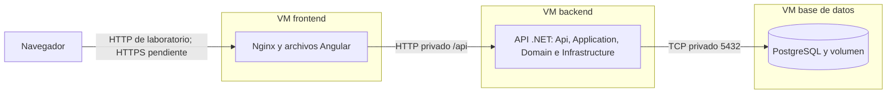

# Despliegue en tres VM

**Definición confirmada el 11 de noviembre de 2026:** frontend, backend y PostgreSQL deben desplegarse en máquinas virtuales distintas. El Compose de la raíz sirve para desarrollo y pruebas locales; no acredita este despliegue.

| Máquina Ubuntu Server | Qué ejecuta | Configuración |
| --- | --- | --- |
| VM frontend | Nginx sirve el build Angular y dirige `/api` al backend. Angular se ejecuta en el navegador. | [vm-frontend](../deploy/vm-frontend/compose.yaml) |
| VM backend | Una API .NET con sus cuatro capas internas. | [vm-backend](../deploy/vm-backend/compose.yaml) |
| VM base de datos | PostgreSQL con volumen persistente. | [vm-db](../deploy/vm-db/compose.yaml) |



## Preparación

1. Confirmar IP privadas, conectividad entre las tres VM y acceso de administración. No se han fijado direcciones reales ni se ha accedido a servidores en esta tarea.
2. Publicar imágenes versionadas de frontend y API mediante el [CI preparado para Docker Hub](PUBLICACION_DOCKERHUB.md), con su token configurado y el PR integrado en `main`. Verificar ambas imágenes en el registro antes de usarlas; el CD a las VM sigue pendiente.
3. En cada VM, copiar solo su carpeta de `deploy/vm-*`, renombrar `.env.example` a `.env` y completar los valores vacíos. No compartir archivos con claves en Git.

| Archivo de configuración | Valores necesarios |
| --- | --- |
| Frontend | `FRONTEND_IMAGE`, `FRONTEND_BIND_ADDRESS` y `API_UPSTREAM`. |
| Backend | `BACKEND_IMAGE`, `BACKEND_BIND_ADDRESS` y `DB_CONNECTION_STRING`. |
| Base de datos | `DB_BIND_ADDRESS`, base, usuario y `POSTGRES_PASSWORD`. |

`API_UPSTREAM` debe ser `http://IP_PRIVADA_VM_BACKEND:8080`, sin `/` final. `DB_CONNECTION_STRING` usa como Host la IP o DNS privado de la VM de BD; no `localhost` ni el nombre Docker `db` de otra máquina.

## Orden de arranque

Desde la carpeta correspondiente de cada VM:

```sh
docker compose --env-file .env pull
docker compose --env-file .env up -d
docker compose --env-file .env ps
```

Arrancar **BD → backend → frontend**. Las redes de Compose pertenecen a cada host; no ofrecen descubrimiento automático entre VM. No se usa `depends_on` para prometer disponibilidad de servicios de otra máquina.

## Comunicación y comprobación

| Origen | Destino | Acceso esperado |
| --- | --- | --- |
| Navegador | VM frontend | Puerto web; HTTPS al preparar el entorno operativo. |
| VM frontend | VM backend | HTTP al puerto privado de API, inicialmente 8080. |
| VM backend | VM BD | TCP al puerto privado PostgreSQL, inicialmente 5432. |

Configurar las reglas de red del laboratorio para permitir estos recorridos, sin publicar API o PostgreSQL directamente a Internet. El frontend no recibe credenciales de la base ni abre conexiones SQL.

Comprobar `/api/health` y `/api/health/ready` **a través de la dirección web de la VM frontend**: el primero valida el proxy hasta la API; el segundo añade conexión a la BD. Un 200 de conectividad no demuestra migraciones o RF completos.

## DEV/PROD y pendientes

Las tres VM son un reparto por servicio; no equivalen a VM DEV y VM PROD. Mantener por ambiente imágenes, configuración, claves, puertos y volúmenes separados. Para PROD, cambiar también `APP_ENVIRONMENT` a `Production` en la VM backend y los nombres de proyecto de sus archivos locales. Este acuerdo no exige por sí solo seis VM: la infraestructura disponible y el aislamiento entre ambientes deben concretarse con el profesor.

Estas plantillas no despliegan automáticamente ni configuran HTTPS, usuarios SQL de ejecución, respaldos o aislamiento de red. No incluyen todavía almacenamiento de imágenes de producto, worker de reportes ni base analítica. Sus ubicaciones y recursos se resolverán al implementar esos módulos, conservando la separación confirmada de frontend, API y PostgreSQL.

La imagen frontend admite el backend privado con `API_UPSTREAM`, usando el [mecanismo de plantillas de la imagen oficial Nginx](https://github.com/nginx/docker-nginx/blob/master/entrypoint/20-envsubst-on-templates.sh). La red entre máquinas debe configurarse aparte de las [redes locales de Compose](https://docs.docker.com/compose/how-tos/networking/).
