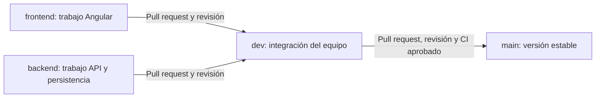

# Guía técnica de Dumbo Supermercados

Los comandos se ejecutan desde la raíz del repositorio, salvo que se indique otra carpeta. Para el inicio rápido, ver el [README](../README.md).

Base del sistema real del Proyecto Integrador de Plataformas. El mockup sigue en su repositorio separado y sirve como referencia visual.

**Estado inicial:** Angular 20 y API ASP.NET Core 10 con controladores, capas y comprobación de conectividad. EF Core/Npgsql está preparado para PostgreSQL. Aún no hay entidades ni migraciones de negocio, autenticación, pagos o correo implementados.

## Estructura

```text
frontend/                      Angular 20, routing, SCSS y cliente HTTP
backend/Dumbo.sln               Solución .NET 10
backend/src/Dumbo.Api/          Controladores y composición de dependencias
backend/src/Dumbo.Application/  Casos de uso, contratos y abstracciones
backend/src/Dumbo.Domain/       Entidades y reglas independientes
backend/src/Dumbo.Infrastructure/ EF Core, repositorios e integraciones
backend/tests/Dumbo.Api.Tests/  Pruebas HTTP de integración
deploy/nginx/                  Angular y proxy /api
docs/                          Arquitectura, contratos y próximos pasos
.github/workflows/ci.yml        Compilación, pruebas y construcción de imágenes
```

Las cuatro capas del backend ejecutan **una API**. No son cuatro microservicios ni cuatro contenedores Docker.

## Requisitos

- SDK .NET 10 estable. `global.json` exige 10.0.100 como base y permite bandas posteriores de .NET 10.
- Node.js 24.15.0 y npm 11; `.nvmrc` conserva la versión del equipo.
- Git y permisos de escritura en este repositorio para colaborar.
- Docker con Compose para levantar PostgreSQL o la aplicación completa.

## Levantar todo con Docker

Desde la raíz del repositorio, copiar `.env.example` a `.env`:

```powershell
Copy-Item .env.example .env
```

En Linux/macOS usar `cp .env.example .env`. Editar `POSTGRES_PASSWORD` con una clave solo de desarrollo y ejecutar:

```sh
docker compose up --build -d
docker compose ps
```

- Interfaz: http://localhost:8080
- API: http://localhost:5080/api/health
- Estado de conexión a PostgreSQL: http://localhost:5080/api/health/ready
- OpenAPI en Development: http://localhost:5080/openapi/v1.json

Nginx sirve Angular y dirige `/api` a la API. No se necesitan reglas CORS permisivas. Los puertos están ligados a loopback para uso local; el despliegue accesible del servidor se acordará aparte con HTTPS y las indicaciones del profesor.

`docker compose down` conserva los datos. No usar `down -v` para reiniciar una aplicación que contenga datos que se quieran conservar.

## Desarrollar Angular y .NET por separado

Terminal 1, desde la raíz:

```sh
dotnet restore backend/Dumbo.sln --locked-mode
dotnet run --project backend/src/Dumbo.Api --launch-profile http
```

Terminal 2:

```sh
cd frontend
npm ci
npm start
```

Abrir http://localhost:4200. El proxy de desarrollo dirige `/api` a `127.0.0.1:5080`. Angular puede iniciar antes de la API: muestra Sin conexión y permite comprobar de nuevo.

Para comprobar PostgreSQL desde la API local:

1. Preparar `.env` y ejecutar `docker compose up -d db`.
2. Guardar la conexión en secretos de desarrollo, usando la clave elegida en `.env`:

```sh
dotnet user-secrets set "ConnectionStrings:Dumbo" "Host=localhost;Port=5432;Database=dumbo;Username=dumbo;Password=TU_CLAVE_DEV;Timeout=3;Command Timeout=5" --project backend/src/Dumbo.Api
```

3. Reiniciar la API. Si cambiaste usuario, base o puerto en `.env`, reflejarlos también en la conexión local.

Sin PostgreSQL, la API responde correctamente a `/api/health`; `/api/health/ready` devuelve un error controlado 503. No se crean tablas automáticamente al iniciar.

## Modelo y migraciones

Antes de la primera migración, Gustavo/Juan y backend deben revisar el modelo y acordar Identity, persistencia del carrito, estados de reservas e intentos de pago. El SQL de referencia debe conciliarse con EF; evitar mantener dos fuentes de esquema divergentes.

Cuando el modelo esté acordado:

```sh
dotnet tool restore
dotnet ef migrations add Inicial --project backend/src/Dumbo.Infrastructure --startup-project backend/src/Dumbo.Api --output-dir Persistence/Migrations
dotnet ef database update --project backend/src/Dumbo.Infrastructure --startup-project backend/src/Dumbo.Api
```

Revisar y versionar la migración antes de aplicarla a un ambiente compartido. Ver [arquitectura](ARQUITECTURA.md) y [contratos](CONTRATOS_API.md).

## Comprobaciones

```sh
dotnet test backend/Dumbo.sln --configuration Release
cd frontend
npm ci
npm run build
npm run test:ci
```

Los tests Angular usan Chrome Headless; se necesita Chrome/Chromium instalado. La prueba .NET con PostgreSQL real se omite si falta `DUMBO_TEST_DATABASE`; CI proporciona una base temporal para ejecutarla. Las demás pruebas no requieren base de datos.

Los archivos `package-lock.json` y `packages.lock.json` quedan versionados. Usar `npm ci`; al cambiar paquetes .NET, restaurar y revisar también los cambios de los locks.

## Trabajo en equipo

### Ramas y recorrido de los cambios



| Rama | Uso | Cómo recibe cambios |
| --- | --- | --- |
| `frontend` | Pantallas Angular, componentes, estilos y clientes HTTP. | Commits del equipo de frontend. |
| `backend` | API, capas, modelo, persistencia y pruebas del backend. | Commits del equipo de backend. |
| `dev` | Integrar y comprobar las partes del sistema juntas. | Pull requests de las ramas de trabajo. |
| `main` | Mantener una versión estable y preparar entregas. | Pull requests provenientes de `dev`. |

Las ramas contienen el repositorio completo: sus nombres organizan el trabajo, no restringen el acceso a carpetas. Los cambios compartidos de infraestructura, contratos o CI se coordinan antes de integrarlos. Si varias personas trabajan a la vez en una misma rama, deben actualizarse antes de subir; también pueden abrir una rama corta por tarjeta para evitar interferencias.

### 1. Trabajar en frontend o backend

Primera vez:

```sh
git clone https://github.com/pvblo47/dumbo-supermercado.git
cd dumbo-supermercado
git fetch origin
git switch frontend
```

Para backend, sustituir `frontend` por `backend`. Git crea la rama local siguiendo la remota cuando todavía no existe localmente.

Antes de cada sesión, con los cambios anteriores guardados:

```sh
git switch frontend
git pull --ff-only origin frontend
```

Después de implementar y comprobar la tarea:

```sh
git status
git add frontend/
git diff --cached
git commit -m "feat: describir la tarea realizada"
git push origin frontend
```

Para backend, usar la rama `backend` y agregar los archivos correspondientes a la tarjeta. Revisar siempre qué se va a subir; las credenciales y los archivos `.env` permanecen fuera de Git.

### 2. Integrar la rama de trabajo en dev

1. Abrir un pull request con **base `dev`** y **compare `frontend` o `backend`**. Relacionarlo con su tarjeta de Trello.
2. Describir qué cambió, cómo se probó y si afecta contratos o migraciones.
3. Esperar los checks de CI y la aprobación de otro integrante con permisos de escritura.
4. Resolver los comentarios y actualizar la rama si GitHub lo solicita. Los cambios nuevos requieren revisar de nuevo.
5. Integrar con **Create a merge commit**. Las ramas `frontend` y `backend` son permanentes: no eliminarlas después del merge.

Después de integrar otras tareas en `dev`, incorporar sus cambios en la rama de trabajo antes de continuar. Ejemplo para frontend:

```sh
git fetch origin
git switch frontend
git pull --ff-only origin frontend
git merge origin/dev
git push origin frontend
```

Si hay conflictos, resolverlos, comprobar la aplicación y completar el merge antes de subir. No usar `push --force` para resolver un rechazo de Git.

### 3. Pasar de dev a main

1. Comprobar el flujo integrado en `dev` y preparar las evidencias de la entrega.
2. Abrir un pull request con **base `main`** y **compare `dev`**.
3. Esperar una aprobación de otro integrante y todos los checks obligatorios en verde.
4. Integrar con **Create a merge commit**. Conservar `dev`.
5. Si `main` queda por delante de `dev`, sincronizarlas mediante un pull request **`main` → `dev`** antes de la siguiente entrega. Después, actualizar las ramas de trabajo desde `dev`.

El check `flujo-ramas` rechaza los pull requests hacia `main` que no provengan de `dev` de este mismo repositorio. Las correcciones también pasan primero por `dev`.

### Protecciones de main y dev

Las protecciones se administran en **GitHub → Settings → Branches**. El archivo [.github/branch-protection.json](../.github/branch-protection.json) permite reproducir esta configuración; versionarlo no activa las restricciones por sí solo. El estado efectivo debe consultarse en GitHub.

La política para ambas ramas exige:

- Pull request y **una aprobación** de otro integrante. Los cambios nuevos invalidan las aprobaciones anteriores y el último push debe revisarlo otra persona.
- Checks `flujo-ramas`, `backend`, `frontend` y `docker` correctos, provenientes de GitHub Actions.
- Rama actualizada respecto del destino y conversaciones resueltas.
- Bloqueo de pushes directos que no cumplan las reglas, pushes forzados y eliminación de ramas.
- Aplicación también al administrador, sin excepciones de bypass configuradas.

El propietario puede aplicar el archivo a cada rama con GitHub CLI, si tiene `gh` instalado y una sesión autenticada con permisos de administración:

```sh
gh api --method PUT repos/pvblo47/dumbo-supermercado/branches/main/protection --input .github/branch-protection.json
gh api --method PUT repos/pvblo47/dumbo-supermercado/branches/dev/protection --input .github/branch-protection.json
```

Consultar el estado efectivo en GitHub después de aplicarlo. Referencia: [protección de ramas de GitHub](https://docs.github.com/en/repositories/configuring-branches-and-merges-in-your-repository/managing-protected-branches/about-protected-branches).

El propietario debe invitar a los integrantes en **Settings → Collaborators**. Con aprobación obligatoria se necesita al menos otro integrante con permisos de escritura para revisar los pull requests; el autor no aprueba su propio trabajo.

### CI y futuro despliegue

CI se ejecuta al subir a `frontend`, `backend`, `dev` o `main`, y en pull requests hacia `dev` y `main`. Comprueba el flujo de ramas, las pruebas del backend con PostgreSQL temporal, la compilación y pruebas de Angular y la construcción de imágenes Docker.

**Todavía no publica en Docker Hub ni despliega en la VM.** El futuro CD debe promover cambios ya revisados: `dev` para el ambiente de integración y `main` para la entrega estable, con sus propios secretos y ambientes. Esa configuración requiere las cuentas y el acceso al servidor acordados.

Primeros pasos: [ARRANQUE_EQUIPO.md](ARRANQUE_EQUIPO.md). Estado de las verificaciones: [VERIFICACION_INICIAL.md](VERIFICACION_INICIAL.md).

## Ambientes

Usar diferentes archivos de configuración, contraseñas, puertos y nombres de proyecto Compose para DEV/PROD. Los volúmenes están ligados al nombre del proyecto: `dumbo-dev` y `dumbo-prod` no comparten automáticamente `postgres-data`. La asignación de cada VM sigue pendiente de la indicación del profesor.

Webpay Plus, Resend, archivos de imágenes persistentes y el worker/base de reportes permanecen en la arquitectura objetivo; no se presentan como implementados en esta base.
